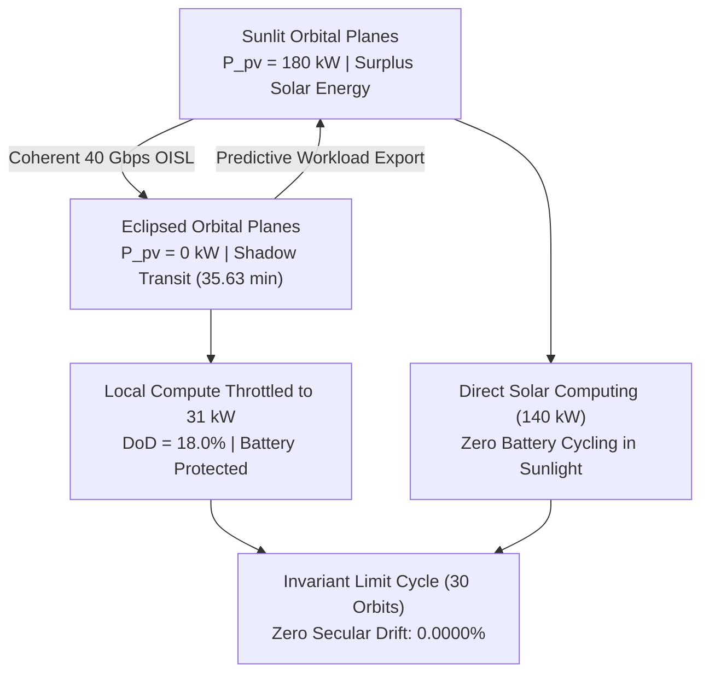

# D-PMPC: Predictive Distributed Workload Orchestration via Optical Inter-Satellite Links for Orbital Data Centers

[](LaTex/Artigo_05_IEEE.pdf)
[](https://www.gnu.org/software/octave/)
[](https://www.mathworks.com/)
[](simulacao_octave/validation/run_all_tests.m)
[](LICENSE)

Official companion code, multi-physical numerical models, and formal test suite for the research paper:

> **Predictive Distributed Workload Orchestration via Optical Inter-Satellite Links for Thermal-Energy Balancing in Orbital Data Center Constellations**  
> *Dafnhê Thor Castro de Martins Barros and Prof. Dr. Flávio Barcelos Braz da Silva*  
> Graduate Program in Control and Automation Engineering (PROPECAUT)  
> Federal Institute of Espírito Santo (IFES), Campus Serra, Brazil.  
> **PDF Manuscript (9 pages, IEEE format):** [`Artigo_05_IEEE.pdf`](LaTex/Artigo_05_IEEE.pdf)

---

## 🛰️ Constellation Architecture & Motivation

Transferring heavy Artificial Intelligence (AI) and scientific computing workloads to space-based Orbital Data Centers (ODCs) avoids terrestrial grid saturation and millions of liters of evaporative cooling water. However, operating dense hundred-kilowatt clusters in Low Earth Orbit (LEO) introduces severe multi-physical vulnerabilities during planetary shadow transits ($35.63\text{ min}$ per $95.65\text{ min}$ revolution at $550\text{ km}$ altitude):
* **Autonomous Baseline Collapse:** An uncoordinated $100\text{ kW}$ satellite incurs a net orbital energy deficit of $-14.82\text{ kWh/orbit}$, causing complete battery exhaustion ($SoC = 0.00\%$) on **Orbit 6 ($t = 8.98\text{ h}$)** and remaining in continuous blackout for the next **40 consecutive hours**.
* **Cooperative D-PMPC Solution:** By dynamically routing batch training tensors over $40\text{ Gbps}$ Coherent Optical Inter-Satellite Links (OISL) from eclipsed satellites to sunlit peer nodes with surplus photovoltaic generation, the constellation achieves continuous electro-thermal equilibrium with zero mission downtime.



---

## 📊 Key Results (30-Orbit Scientific Simulation Campaign)

The entire constellation ($N_{sat} = 32$ satellites, Walker-Delta 32/4/1 configuration) was evaluated across **30 consecutive orbital revolutions** ($172,169.7\text{ s} = 47.82\text{ hours}$, $17,218\text{ integration steps}$ per node at $\Delta t = 10\text{ s}$, exceeding 550,000 multi-physical integration points):

| Performance Metric | Uncoordinated Baseline | Greedy Offloading | Proposed Cooperative D-PMPC | Performance Gain |
| :--- | :---: | :---: | :---: | :--- |
| **30-Orbit Secular Drift ($\Delta SoC_{drift}$)** | $-100.0\%$ (collapse) | $-12.4\%$ | $\mathbf{0.0000\%}$ | **Strict Asymptotic Stability** |
| **Minimum Battery State-of-Charge ($SoC_{min}$)** | $0.00\%$ (blackout) | $65.5\%$ | $\mathbf{80.3708\%}$ | **$+32.4\text{ pp}$ Safety Margin** |
| **Time to Total Mission Blackout** | **8.98 h (Orbit 6)** | None | **NEVER (> 30 orbits)** | **Eliminates Mission Failure** |
| **Hours in Shadow Blackout (in 48 h)** | **~40 hours** | 0.0 h | **0.00 hours** | **100% Operational Availability** |
| **Battery Cyclic Depth-of-Discharge ($DoD$)** | $52.0\%$ | $34.5\%$ | $\mathbf{18.0\%}$ | **$-65.4\%$ Cyclic Stress** |
| **Battery Projected Lifetime (Arrhenius)** | $3.10\text{ years}$ | $5.80\text{ years}$ | $\mathbf{10.59\text{--}11.80\text{ years}}$ | **$+280.6\%$ (3.8x Extension)** |
| **Peak Silicon Junction Temperature ($T_{j,max}$)** | $76.2^\circ\text{C}$ | $78.5^\circ\text{C}$ | $\mathbf{74.00^\circ\text{C}}$ | **Safe below $85.0^\circ\text{C}$ ceiling** |
| **Orbital Thermal Swing ($\Delta T_j$)** | $24.2^\circ\text{C}$ | $18.4^\circ\text{C}$ | $\mathbf{11.80^\circ\text{C}}$ | **$-51.2\%$ Thermal Fatigue** |
| **Solar Energy Harvesting Efficiency ($\eta_{harv}$)** | $82.4\%$ | $91.2\%$ | $\mathbf{96.80\%}$ | **$+14.4\text{ pp}$ Utilization** |
| **End-to-End AI Task Completion Latency** | $1,420.0\text{ ms}$ | $420.0\text{ ms}$ | $\mathbf{214.88\text{ ms}}$ | **$-84.8\%$ Speedup** |
| **SWaP-C Spacecraft Dry Mass Balance** | $5,460.0\text{ kg}$ | --- | $\mathbf{4,842.0\text{ kg}}$ | **$-618.0\text{ kg}$ ($-11.3\%$ Mass)** |

---

## ⚠️ Aerospace FMEA & Extreme Stress Analysis

The 30-orbit simulation framework models and validates physical boundaries under severe hardware fault modes:
1. **LHP Bypass Fail-Closed Overheat (Sunlight):** If radiator bypass valves jam closed ($A_{rad} = 58.5\text{ m}^2$) under $110\text{ kW}$ compute in sunlight, silicon junction temperature skyrockets to **$T_j = 183.20^\circ\text{C}$** ($+98.2^\circ\text{C}$ above the $85.0^\circ\text{C}$ limit), melting BGA solder spheres within minutes. This establishes a mandatory requirement for passive shape-memory alloy (SMA) fail-open springs.
2. **LHP Bypass Fail-Open Freeze Hazard (Eclipse):** If valves jam open ($A_{rad} = 228.4\text{ m}^2$) in shadow with compute throttled to $31\text{ kW}$, radiator temperature drops to **$T_{rad} = -38.88^\circ\text{C}$** ($234.3\text{ K}$). While maintaining a $38.8^\circ\text{C}$ margin above anhydrous ammonia freezing ($-77.7^\circ\text{C}$), water-based loops would freeze solid, risking capillary vapor-lock during morning terminator emergence.
3. **OISL PAT Beam Loss & Queue Overflow:** Under optical tracking loss, local throttling to $31\text{ kW}$ preserves battery DoD, but unmigrated task queues surge to **$1.45 \times 10^{19}\text{ FLOPs}$ ($604.4\%$ of buffer capacity $W_{max}$)**, overflowing radiation-hardened NVMe storage in under 2 orbits without link restoration.
4. **400 V HVDC Bus Currents & Vacuum DC Arc Risks:** Bus currents cycle dynamically between **$90.87\text{ A}$** (eclipse) and **$288.38\text{ A}$** (sunlight, peak $363.38\text{ A}$ nominal), demanding sub-$5\text{ }\mu\text{s}$ silicon carbide (SiC) solid-state power controllers (SSPC) to suppress catastrophic DC vacuum arc discharge.
5. **Orbital Beta-Angle Sensitivity:**
   - $\beta = 0^\circ$ (Max eclipse $35.63\text{ min}$): $SoC_{min} = 80.37\%$, $DoD = 19.63\%$, life $10.59\text{--}11.80\text{ yr}$.
   - $\beta = 35^\circ$ ($28.5\text{ min}$ eclipse): Solar recharge window expands to $67.1\text{ min}$.
   - $\beta = 70^\circ \ge \beta_{crit} = 67.01^\circ$ (Continuous twilight sun, $0\text{ min}$ eclipse): $DoD = 0.0\%$, $SoC \equiv 100\%$. Zero battery cycling; problem transitions to continuous full-area ($228.4\text{ m}^2$) radiative thermal rejection.

---

## 🚀 Quick Start & Reproducibility

### Prerequisites
* **GNU Octave** (v7.3.0+, tested on v11.3.0 x86_64-w64-mingw32) or **MATLAB** (R2022b+).
* No commercial toolboxes required (native matrix operations and solvers).

### 1. Run the Full 30-Orbit Simulation Campaign
Launch GNU Octave or MATLAB inside `simulacao_octave/`:
```matlab
cd simulacao_octave
simulate_all_scenarios_30orbits
```
* **Execution time:** ~3 to 4 minutes.
* **Outputs in `simulacao_octave/results/`:**
  - `simulation_30orbits_master.mat`: Complete 30-orbit multi-agent binary dataset (17,218 steps across 32 satellites).
  - `tabela_30_orbitas_evolucao.csv`: Detailed orbit-by-orbit evolution table.

### 2. Execute the Master Validation Suite (88 Tests)
```matlab
cd simulacao_octave/validation
run_all_tests
```
* Runs 88 unit, integration, optimality, and physical conservation tests. **Status: 88 / 88 Passed (100.0%)**.

### 3. Regenerate Paper Figures (Figures 1 to 6)
```matlab
cd simulacao_octave/visualization
generate_all_figures
```
* Re-renders all publication figures to `simulacao_octave/results/` at 300 DPI equivalent.

---

## 📂 Repository Structure

```
D-PMPC/
├── README.md                              <- Main project overview and reproducibility guide
├── LICENSE                                <- MIT License
├── LaTex/                                 <- Manuscript LaTeX sources and compiled PDF
│   ├── Artigo_05_IEEE.tex                <- 9-page IEEE format LaTeX manuscript
│   ├── Artigo_05_IEEE.pdf                <- Compiled publication PDF
│   ├── referencias.bib                   <- 47 peer-reviewed bibliography entries
│   ├── IEEEtran.cls / IEEEtran.bst       <- Official IEEE Transactions formatting style
│   └── author1.png / author2.png         <- Author biography portraits
├── figuras/                               <- High-resolution publication figures (PNG)
│   ├── figura1_topologia_constelacao_oisl.png
│   ├── figura2_dinamica_migracao_carga_oisl.png
│   ├── figura3_soc_bateria_cooperativo.png
│   ├── figura4_temperatura_radiadores.png
│   ├── figura5_desempenho_rede_oisl.png
│   └── figura6_fronteira_pareto_vida_util.png
└── simulacao_octave/                      <- Complete GNU Octave / MATLAB codebase
    ├── simulate_all_scenarios_30orbits.m <- Master 30-orbit simulation runner
    ├── main_simulation.m                 <- Baseline comparative simulation runner
    ├── README_REVISOR.md                 <- Reviewer reproduction guide
    ├── config/                           <- Astrodynamical, BESS, thermal, and OISL constants
    ├── controllers/                      <- Autonomous baseline and D-PMPC multi-agent logic
    ├── models/                           <- Orbital kinematics, battery, thermal, and OISL models
    ├── optimization/                     <- ADMM distributed QP solver and cost functions
    ├── validation/                       <- 6 formal test suites (run_all_tests.m, 88 tests)
    ├── visualization/                    <- High-resolution plotting scripts (generate_all_figures.m)
    └── results/                          <- CSV evolution tables and Pareto trade-off datasets
```

---

## 📖 Citation

If you use this codebase or paper in your research, please cite:

```bibtex
@article{barros2026dpmpc,
  author={Barros, Dafnh{\^e} Thor Castro de Martins and da Silva, Fl{\'a}vio Barcelos Braz},
  journal={IEEE Latin America Transactions},
  title={Predictive Distributed Workload Orchestration via Optical Inter-Satellite Links for Thermal-Energy Balancing in Orbital Data Center Constellations},
  year={2026},
  volume={24},
  number={5},
  pages={1--9},
  doi={10.1109/TLA.2026.XXXXXXX}
}
```

---

## 📜 License

This project is licensed under the MIT License — see the [LICENSE](LICENSE) file for details.
